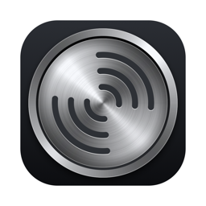

  

<h1 align="center">Sonar</h1>

  <b>See the tempo (BPM) of whatever your Mac is playing, right in the menu bar.</b> 
  Spotify, Apple Music, YouTube, SoundCloud, a DJ set in your browser: if you can hear it, Sonar can count it.

  <a href="https://github.com/kvanagas/sonar/releases/latest"><b>⬇ Download Sonar for Mac</b></a>

---

## What it does

- **Shows the BPM live.** A small number in the menu bar tells you how fast the song is, and can gently pulse on the beat.
- **Works with anything.** It listens to your Mac's sound, so it doesn't matter which app or website is playing.
- **Knows the song.** It picks up the track name from Spotify and Apple Music, and recognises everything else with Shazam.
- **Remembers what you heard.** Every song is saved with its tempo and where it played, so you can find it later, search, or export the list to a spreadsheet.

Handy for DJs digging for tracks, runners and dancers looking for songs at the right pace, producers, or anyone curious.

## Install

You need a Mac with **macOS 15 (Sequoia) or newer**.

1. **[Download the latest Sonar](https://github.com/kvanagas/sonar/releases/latest).** On that page, click the file ending in **`.dmg`** under *Assets*.
2. **Open the downloaded file.** A window appears with the Sonar icon and an Applications folder.
3. **Drag Sonar onto the Applications folder.**
4. **Open Sonar** from your Applications folder (or search for it with ⌘-Space).

Sonar lives in the **menu bar** at the top-right of your screen. It has no Dock icon or main window. Look for a small round button with sound waves on it, the same design as the app icon above.

Sonar is signed and checked by Apple, so it opens without security warnings.

## How to use it

| To… | Do this |
| --- | --- |
| Start or stop listening | **Click** the Sonar icon, or press **⌃⌥⌘B** (Control-Option-Command-B) |
| See options, recent songs and settings | **Right-click** the icon |
| See every song Sonar has heard | Right-click → Recent Tracks → **Show All Tracks…**, or press **⌃⌥⌘T** |
| Listen to just one app (e.g. only Spotify) | Right-click → **Listen To** → pick the app |
| Start Sonar automatically | Right-click → **Launch at Login** |

While listening, the number next to the icon is the BPM. It looks faded for a few seconds while Sonar is still working out the tempo.

In **All Tracks**, double-click a song to open it in Spotify, Apple Music or Shazam, or right-click it to search for it on SoundCloud, Bandcamp or Discogs.

### The first time

macOS asks for permission before Sonar can hear anything. Click **Allow** when you see:

- **"Sonar would like to record system audio"**: needed to hear the music and measure its tempo.
- **"Sonar wants to control Spotify / Music / Google Chrome…"**: needed to read the song name, and which web page is playing. You can say no; Sonar still shows the BPM.

## Updates

Sonar checks for new versions once a day and asks before installing one. You can also check any time: right-click the icon → **Check for Updates…**.

## Privacy

- **Your audio stays on your Mac.** Sonar measures the tempo on your computer and never records or saves audio.
- **Song recognition** sends a short digital fingerprint of the sound (not the audio itself) to Apple's Shazam service. Turn it off with right-click → **Identify Songs with Shazam**.
- **Your song history stays on your Mac**, in your user Library folder. Nothing is uploaded.
- **Browser pages:** when music plays in a browser, Sonar remembers the page so you can go back to it. It ignores private/incognito windows, and for sites other than music and video sites it keeps only the page address, not the extra details after it. Turn this off with right-click → **Save Browser Page**.

## Troubleshooting

**I can't see the icon.** On MacBooks with a notch, menu bar icons can be hidden behind it when the bar is full. Quit an app you don't need in the menu bar, or hold ⌘ and drag Sonar's icon further right.

**It says "Listening…" but no BPM appears.** Make sure something is actually playing and isn't muted. If it still doesn't work, open **System Settings → Privacy & Security → Screen & System Audio Recording** and make sure Sonar is turned on.

**The song name doesn't show.** Open **System Settings → Privacy & Security → Automation** and turn on Spotify, Music or your browser under Sonar. For other apps, leave **Identify Songs with Shazam** on and give it a few seconds.

**The BPM is half or double what I expected.** Some songs can feel like either. Sonar picks the most likely one, but for very slow or very fast music it can land on the other.

**How do I uninstall it?** Quit Sonar (right-click → Quit Sonar) and drag it from Applications to the Trash. To also delete your song history, remove the folder `~/Library/Application Support/Sonar`.

**Found a bug or have an idea?** [Open an issue](https://github.com/kvanagas/sonar/issues).

---

## For developers

Sonar is a native Swift / SwiftUI app. It captures audio with a Core Audio process tap, detects tempo with its own onset and tempo estimator, identifies songs with ShazamKit, and updates with [Sparkle](https://sparkle-project.org).

**Build it**

1. Install [XcodeGen](https://github.com/yonaskolb/XcodeGen): `brew install xcodegen`
2. In `project.yml`, set `DEVELOPMENT_TEAM` to your team ID and change the bundle ID prefix; update `Sonar/Sonar.entitlements` to match. Song recognition needs an App ID with the ShazamKit service enabled.
3. Run `xcodegen generate`, open `Sonar.xcodeproj` and run.

Tests: `xcodebuild -project Sonar.xcodeproj -scheme Sonar test`

**Release it.** `scripts/release.sh` archives, signs with Developer ID, notarizes, and writes `build/release/Sonar-<version>.dmg` plus the Sparkle `appcast.xml`. Attach both to a GitHub release tagged `v<version>`. Bump `MARKETING_VERSION` and `CURRENT_PROJECT_VERSION` in `project.yml` first; the comment at the top of the script lists the keychain items it needs.

**Icons.** The app and menu bar icons are generated by the scripts in `Design/`.

## License

[MIT](LICENSE) © 2026 Karolis Vanagas
